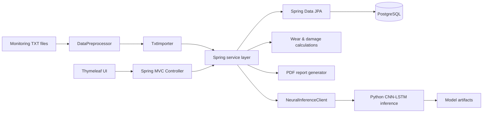

# Crane Monitoring System

Information system for processing crane equipment monitoring data, estimating wear and residual resource, and forecasting the next operating period with a CNN-LSTM model.

The project was developed as a bachelor's thesis and received an **implementation act from an industry company specializing in crane equipment repair and maintenance**.

## Tech stack

**Backend:** Java 17, Spring Boot 3, Spring MVC, Spring Data JPA, Hibernate  
**Database:** PostgreSQL  
**Frontend:** Thymeleaf, HTML, CSS, JavaScript  
**Reporting:** Apache PDFBox  
**ML module:** Python, PyTorch, NumPy, scikit-learn, CNN-LSTM  
**Testing:** JUnit 5, Spring Boot Test, MockMvc, H2  
**Build:** Maven

## What the system does

- imports structured monitoring data from TXT files;
- creates and maintains crane operation history in PostgreSQL;
- calculates load distribution and mechanism workload;
- stores visual inspections and operating events;
- calculates damage, wear percentage and residual resource;
- visualizes historical trends on an engineering dashboard;
- generates PDF reports;
- forecasts the next operating period using a CNN-LSTM model after at least five historical periods are available.

A test dataset with 36 TXT files for six crane models is included in [`sample-data`](sample-data).

## Architecture



The Java application is organized into `web`, `service`, `repository` and `model` layers. The ML inference process is isolated from the main Spring Boot application and communicates with Java through JSON via standard input/output.

## Domain model

The PostgreSQL schema stores:

- cranes;
- uploaded operating periods;
- load profiles;
- mechanism workloads;
- visual inspections;
- operating events;
- calculated metrics;
- forecast results;
- generated report metadata.

The schema is initialized from [`src/main/resources/schema.sql`](src/main/resources/schema.sql).

## Run locally

### Requirements

- Java 17+
- Maven 3.9+
- Docker / Docker Compose (recommended for PostgreSQL)

Python is only required if you want to enable CNN-LSTM forecasting.

### 1. Start PostgreSQL

```bash
docker compose up -d
```

The provided Compose configuration starts PostgreSQL 16 on port `5432` with local development credentials matching the default Spring configuration.

### 2. Run the application

```bash
mvn spring-boot:run
```

Open:

```text
http://localhost:8080
```

### 3. Load demo data

Upload TXT files from the [`sample-data`](sample-data) directory through the web interface. The application creates crane cards and builds analytics from the imported periods.

## CNN-LSTM forecasting

Neural forecasting is **disabled by default**, so the Java application can be started without Python or trained model files.

Training is documented in [`ml/cnn_lstm_training.ipynb`](ml/cnn_lstm_training.ipynb). The notebook expects a prepared synthetic training dataset named `crane_training_dataset_1080.csv`. That dataset and the trained model artifacts were not present in the source archive and are therefore not included in this public-ready version.

Install the Python dependencies:

```bash
pip install -r ml/requirements.txt
```

After training, the inference module expects these generated artifacts:

```text
model_config.json
cnn_lstm_model.pt
scaler_x.pkl
scaler_y.pkl
```

Store them in `ml/models` or point `CRANE_NEURAL_MODEL_DIR` to another directory. Then configure:

```text
CRANE_NEURAL_ENABLED=true
CRANE_NEURAL_PYTHON=/absolute/path/to/python
CRANE_NEURAL_MODEL_DIR=/absolute/path/to/ml/models
```

The Java service sends a five-period feature window to the Python inference process as JSON and receives the predicted operating parameters, damage index, wear and remaining resource.

## Tests

Run:

```bash
mvn test
```

The main integration tests use an in-memory H2 database in PostgreSQL compatibility mode. The real CNN-LSTM integration test is opt-in and runs only when `RUN_NEURAL_INTEGRATION_TEST=true` is set.

GitHub Actions configuration is included in [`.github/workflows/ci.yml`](.github/workflows/ci.yml).

## Project structure

```text
src/main/java/ru/crain/
├── model/          JPA entities
├── repository/     Spring Data repositories
├── service/        import, analytics, forecasting and reporting
└── web/            MVC controllers

src/main/resources/
├── ml/             Python inference entry point
├── static/         CSS and JavaScript
├── templates/      Thymeleaf templates
└── schema.sql      PostgreSQL schema

sample-data/        TXT files for demonstration and integration tests
ml/                 CNN-LSTM training notebook and Python dependencies
database/           database utility and migration scripts
```

## Notes

- The repository contains test/demo monitoring data only.
- Trained ML artifacts are intentionally excluded from Git because they are generated files and may be large.
- Database credentials and ML paths can be overridden through environment variables.
