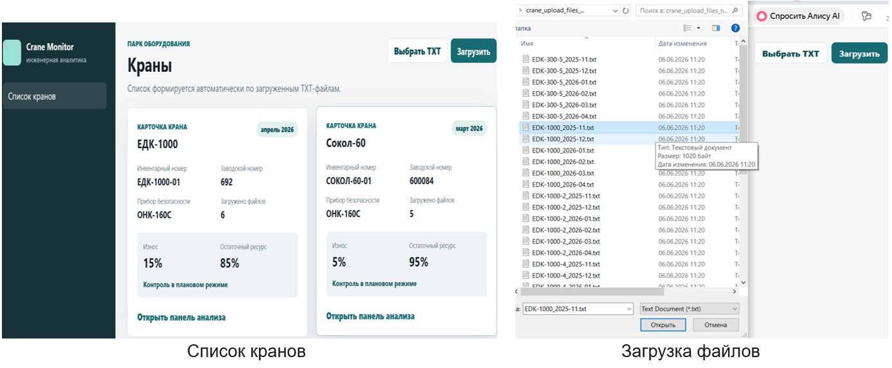
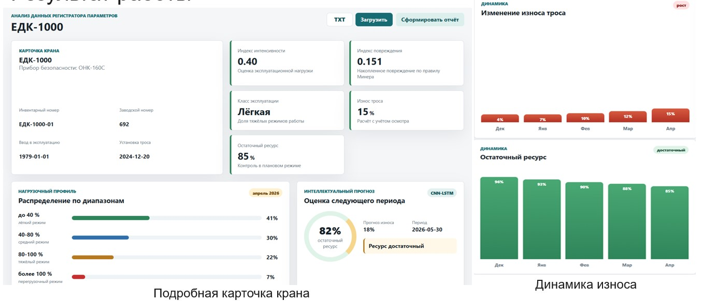
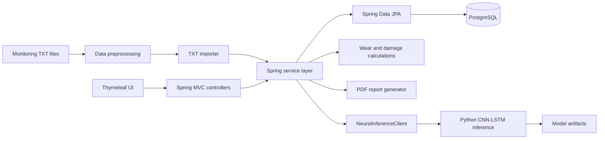

# Crane Monitoring System

[](https://www.oracle.com/java/)
[](https://spring.io/projects/spring-boot)
[](https://www.postgresql.org/)
[](https://github.com/aliipri/crane-monitoring-system/actions/workflows/ci.yml)

A Spring Boot information system for processing crane equipment monitoring data, estimating wear and residual resource, visualizing operating history, generating reports, and forecasting the next operating period with a CNN-LSTM model.

The project was developed as a bachelor's thesis and has a practical focus: **an official implementation act was issued by a company specializing in crane equipment repair and maintenance**.

## Highlights

- layered backend architecture with Spring Boot;
- PostgreSQL persistence through Spring Data JPA / Hibernate;
- transactional import and validation of TXT monitoring data;
- engineering calculations for load, accumulated damage, wear and residual resource;
- historical analytics and visualization;
- PDF report generation;
- integration of Java backend with a Python/PyTorch CNN-LSTM inference module;
- integration and MVC tests;
- Docker Compose configuration for local PostgreSQL;
- GitHub Actions CI for automated Maven tests.

## Screenshots

### Crane list and TXT data upload



The main page displays monitored cranes and their current technical state. Operational data can be uploaded from TXT files generated by crane safety devices. After validation, the data is stored in PostgreSQL and becomes available for further analysis.

### Crane analytics dashboard and wear dynamics



The analytics dashboard provides a detailed view of the selected crane, including:

- load intensity index;
- accumulated damage;
- rope wear percentage;
- residual resource;
- load profile distribution;
- historical wear dynamics;
- residual-life dynamics;
- CNN-LSTM forecast for the next operating period.

The dashboard combines calculated engineering indicators with the neural-network forecast to support analysis of the crane's technical condition and maintenance planning.

## Tech stack

**Backend:** Java 17, Spring Boot 3, Spring MVC, Spring Data JPA, Hibernate  
**Database:** PostgreSQL  
**Frontend:** Thymeleaf, HTML, CSS, JavaScript  
**Reporting:** Apache PDFBox  
**ML module:** Python, PyTorch, NumPy, scikit-learn, CNN-LSTM  
**Testing:** JUnit 5, Spring Boot Test, MockMvc, H2  
**Build:** Maven  
**Infrastructure:** Docker Compose, GitHub Actions

## What the system does

The application processes operational data exported from crane safety devices and builds a history for each monitored crane.

Main functionality:

- imports structured monitoring data from TXT files;
- validates and preprocesses uploaded data;
- creates and maintains crane operation history in PostgreSQL;
- calculates load distribution and mechanism workload;
- stores visual inspections and operating events;
- calculates accumulated damage, wear percentage and residual resource;
- visualizes historical trends on an engineering dashboard;
- generates PDF reports;
- forecasts the next operating period using a CNN-LSTM model after at least five historical periods are available.

A demo dataset with TXT monitoring files is included in [`sample-data`](sample-data).

## Architecture



The Java application follows a layered structure:

```text
Controller -> Service -> Repository -> PostgreSQL
                      |
                      +-> PDF reporting
                      |
                      +-> Python / PyTorch forecasting
```

The ML module is isolated from the main Spring Boot application. Java sends input features to the Python inference process as JSON and receives prediction results back in JSON format.

## Data processing flow

1. The user selects a TXT file exported from a crane safety device.
2. The application validates and preprocesses the input data.
3. Operational data is persisted transactionally in PostgreSQL.
4. The service layer calculates engineering indicators such as load profile, accumulated damage, wear and residual resource.
5. Historical periods are displayed on the analytics dashboard.
6. When enough historical periods are available, the application can send a feature window to the CNN-LSTM model for forecasting.
7. The user can generate a PDF report with the calculated results.

## Domain model

The PostgreSQL schema stores data related to:

- cranes;
- uploaded operating periods;
- load profiles;
- mechanism workloads;
- visual inspections;
- operating events;
- calculated metrics;
- forecast results;
- generated reports.

The schema is initialized from [`src/main/resources/schema.sql`](src/main/resources/schema.sql).

## Run locally

### Requirements

- Java 17+
- Maven 3.9+
- Docker / Docker Compose — recommended for PostgreSQL

Python is **not required** for the basic application startup. The CNN-LSTM module is disabled by default.

### 1. Clone the repository

```bash
git clone https://github.com/aliipri/crane-monitoring-system.git
cd crane-monitoring-system
```

### 2. Start PostgreSQL

```bash
docker compose up -d
```

The provided configuration starts PostgreSQL 16 on port `5432` with the default local development settings:

```text
Database: crane_monitoring
Username: postgres
Password: postgres
```

These values can be overridden with environment variables.

### 3. Run the application

```bash
mvn spring-boot:run
```

Open:

```text
http://localhost:8080
```

### 4. Load demo data

Upload TXT files from the [`sample-data`](sample-data) directory through the web interface.

The application will create crane cards, store operating history and build analytics from the imported periods.

## Configuration

The main configuration can be overridden through environment variables:

```text
DB_URL=jdbc:postgresql://127.0.0.1:5432/crane_monitoring
DB_USERNAME=postgres
DB_PASSWORD=postgres

CRANE_NEURAL_ENABLED=false
CRANE_NEURAL_PYTHON=/absolute/path/to/python
CRANE_NEURAL_MODEL_DIR=/absolute/path/to/ml/models
CRANE_NEURAL_TIMEOUT_SECONDS=30
CRANE_NEURAL_BACKFILL_ON_STARTUP=false
```

See [`.env.example`](.env.example) for an example configuration.

## CNN-LSTM forecasting

Neural forecasting is **disabled by default**, so the Java application can be started and explored without Python or trained model files.

Training is documented in [`ml/cnn_lstm_training.ipynb`](ml/cnn_lstm_training.ipynb).

The training notebook expects a prepared dataset named:

```text
crane_training_dataset_1080.csv
```

The training dataset and generated model artifacts were not present in the original project archive and are therefore not included in this public repository.

Install Python dependencies with:

```bash
pip install -r ml/requirements.txt
```

After training, the inference module expects the following generated artifacts:

```text
model_config.json
cnn_lstm_model.pt
scaler_x.pkl
scaler_y.pkl
```

Store them in:

```text
ml/models
```

or specify another directory through `CRANE_NEURAL_MODEL_DIR`.

To enable inference:

```text
CRANE_NEURAL_ENABLED=true
CRANE_NEURAL_PYTHON=/absolute/path/to/python
CRANE_NEURAL_MODEL_DIR=/absolute/path/to/ml/models
```

The Java service sends a five-period feature window to the Python process as JSON. The CNN-LSTM model returns predicted operating parameters that are used to calculate forecast damage, wear and remaining resource.

## Tests

Run all standard tests with:

```bash
mvn test
```

The main integration tests use an in-memory H2 database in PostgreSQL compatibility mode.

The real CNN-LSTM integration test is opt-in and runs only when:

```text
RUN_NEURAL_INTEGRATION_TEST=true
```

GitHub Actions configuration is available in [`.github/workflows/ci.yml`](.github/workflows/ci.yml).

## Project structure

```text
crane-monitoring-system/
├── .github/
│   └── workflows/          GitHub Actions CI
├── database/               database utilities
├── docs/
│   └── screenshots/        application screenshots
├── ml/                     CNN-LSTM training notebook and Python dependencies
├── sample-data/            demo TXT monitoring files
├── src/
│   ├── main/
│   │   ├── java/ru/crain/
│   │   │   ├── model/      JPA entities
│   │   │   ├── repository/ Spring Data repositories
│   │   │   ├── service/    import, analytics, forecasting and reporting
│   │   │   └── web/        MVC controllers
│   │   └── resources/
│   │       ├── ml/         Python inference entry point
│   │       ├── static/     CSS and JavaScript
│   │       ├── templates/  Thymeleaf templates
│   │       └── schema.sql  PostgreSQL schema
│   └── test/               unit and integration tests
├── .env.example
├── .gitignore
├── docker-compose.yml
├── pom.xml
└── README.md
```

## Practical relevance

The system was created to reduce manual processing of crane operational data and provide engineers with a single tool for analysing equipment condition, wear dynamics and residual resource.

The project was presented to a company specializing in crane equipment repair and maintenance. **An official implementation act was issued based on the project results**, confirming its practical relevance for the target domain.

## Author

**Alina Prilepo**  
Java Backend Developer  
Moscow

Main areas of interest: Java backend development, Spring ecosystem, relational databases, application architecture, data processing and AI/ML integrations.
